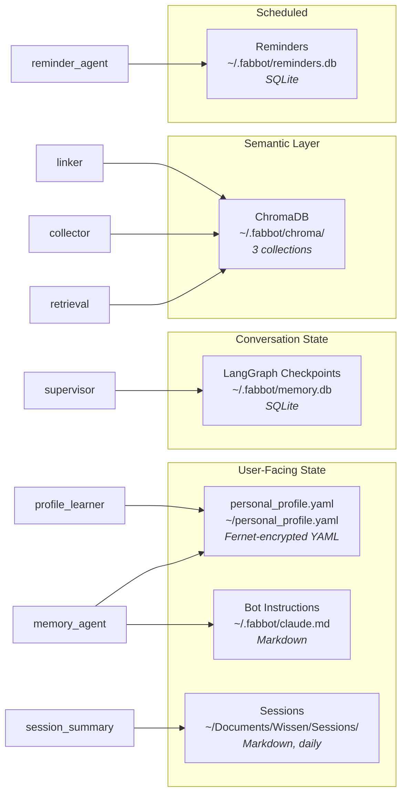

# FabBot - Personal Companion


A personal AI companion that runs locally on macOS, controlled via Telegram. Built with Claude (Anthropic), LangGraph, and a multi-agent architecture.

---

## Overview

```
You → Telegram (text or voice or photo) → Security Guard → Supervisor (Haiku) → calendar_agent / terminal_agent / file_agent / web_agent / chat_agent / vision_agent / ...
```

---

## Features

**Interface & Control** – Telegram bot (text/voice/photo), user authentication (whitelist), human-in-the-loop confirmation for all destructive actions

**Agents** – Terminal (shell commands), File (read/write/list), Web (Tavily+Brave search + fetch), Calendar (Apple), Chat (conversation history + follow-ups), Vision (Claude Sonnet, objects/OCR/scene), Computer Use (screenshot + desktop control), WhatsApp (whatsapp-web.js, HITL, QR via Telegram), Knowledge Clipper (`/clip <URL>` → Obsidian), Knowledge Search (`/search <term>`)

**Memory & Learning** – Persistent conversation memory (SQLite), `personal_profile.yaml` injected into all agents, `/remember` + "Merke dir das" live learning, 3-stage auto-learning pipeline (Detector → Writer → Reviewer), Memory Agent (natural language profile updates), nested Preferences system (`preferences.<subcategory>.<key>`), Session Summary (daily 23:30), Second Brain (ChromaDB semantic retrieval), persistent `claude.md` bot instructions (learnable, survives context trim)

**Voice & Media** – Voice notes (Whisper, local transcription), TTS (OpenAI nova/shimmer + edge-tts fallback, Mac speaker + Telegram voice, `/tts on|off`, `/stop`), media tracking (songs/films/podcasts/books), Weekend Party Report (weekly, 7 Berliner Clubs, Wednesdays 20:00)

**Security** – Two-stage prompt injection guard (pattern + LLM-Guard via Haiku, fail-closed), content isolation for web/clip agents, tamper-evident audit log, at-rest encryption (`personal_profile.yaml` via Fernet + macOS Keychain), SSRF + DNS-Rebinding protection (IPv4 + IPv6 via `getaddrinfo`), SSL validation, path/symlink traversal prevention, subprocess env isolation (no API-key leakage)

**Operations** – GitHub Actions CI (1956 tests), 529 retry (exponential backoff 2s/4s/8s), prompt caching (claude.md + sessions + profile, TTL 60s), context trim (`CHAT_CONTEXT_WINDOW`, default 20), Whisper preload at startup, daily health check (06:00, 13 components), proactive heartbeat (hourly, 6h cooldown, focus-mode aware), model config via `.env` (`ANTHROPIC_MODEL_SONNET/HAIKU`), Telegram `Conflict` debouncing against restart loops, WhatsApp sidecar supervision (port check, orphan cleanup, child-aware shutdown)

---

## Architecture

```
FabBot/
├── main.py                  # Entrypoint
├── personal_profile.yaml    # Personal profile (local only, not in repo)
├── requirements.txt         # Pinned dependencies (install from this)
├── requirements-ci.txt      # CI dependencies (no macOS-only packages)
├── .env.example             # Environment variable template
├── review_log.sh            # Daily log summary script
├── git_remote_guard.py      # pre-commit hook – blocks credentials in git remote URLs
├── deploy/
│   └── com.fabbot.agent.plist  # Launch Agent (absolute paths, venv on internal disk)
├── .github/workflows/test.yml
├── tests/                   # pytest suite (1956 tests)
├── agent/
│   ├── supervisor.py        # Supervisor – Haiku routing, AsyncSqliteSaver, _PRE_ROUTING_RULES
│   ├── state.py             # LangGraph AgentState
│   ├── llm.py               # get_llm() Sonnet + get_fast_llm() Haiku
│   ├── protocol.py          # Protocol constants (HITL magic strings)
│   ├── security.py          # Two-stage injection guard, weighted scoring, fail-closed
│   ├── audit.py             # Tamper-evident audit log (setup_audit_logger)
│   ├── claude_md.py         # claude.md loader – persistent bot instructions
│   ├── crypto.py            # At-rest encryption via Fernet + macOS Keychain
│   ├── profile.py           # Personal context loader
│   ├── profile_learner.py   # Auto-learning pipeline (Detector → Writer → Reviewer)
│   ├── retrieval.py         # Second Brain – ChromaDB + OpenAI Embeddings
│   ├── node_utils.py        # wrap_agent_node Decorator – last_agent_result/name
│   ├── utils.py             # extract_llm_text + shared helpers
│   ├── telemetry.py         # LangSmith tracing (optional)
│   ├── proactive/
│   │   ├── collector.py     # Entity extraction via Haiku, SHA256-upsert into ChromaDB
│   │   ├── pending.py       # Pending Items Tracker – priority score (due_date/mentions)
│   │   ├── linker.py        # Context Linking – entity_links collection, Cluster-API
│   │   ├── briefing_agent.py# Multi-Agent Briefing Orchestrator (asyncio.gather, 5s timeout)
│   │   ├── heartbeat.py     # Hourly heartbeat, time-triggered, 6h cooldown
│   │   └── context.py       # Proactive context aggregator for chat_agent
│   └── agents/
│       ├── chat_agent.py    # Dynamic prompt – claude.md + sessions + profile + retrieval + proactive
│       ├── memory_agent.py  # Profile updates, delete-aware _review_yaml
│       ├── vision_agent.py  # Image analysis via Claude Sonnet Vision
│       ├── computer.py      # Desktop control (screenshot, apps)
│       ├── terminal.py      # Shell commands, self-correction (MAX_RETRIES=2)
│       ├── file.py          # File operations (read/write/list)
│       ├── web.py           # Web search (Tavily+Brave) + fetch
│       ├── calendar.py      # Apple Calendar (read/create)
│       ├── reminder_agent.py
│       ├── whatsapp_agent.py# WhatsApp via whatsapp-web.js, HITL
│       └── clip_agent.py    # Knowledge Clipper → Obsidian
├── bot/
│   ├── bot.py               # Telegram handler, HITL, retry logic, exception handler
│   ├── conflict_tracker.py  # Debounces Telegram Conflicts (3 within 300s → exit)
│   ├── auth.py              # User-Whitelist (fail-closed, RuntimeError if empty)
│   ├── confirm.py           # HITL confirmation (full UUID)
│   ├── transcribe.py        # Local Whisper transcription
│   ├── tts.py               # OpenAI TTS (primary) + edge-tts (fallback)
│   ├── search.py            # Local knowledge search
│   ├── briefing.py          # Morning Briefing Scheduler (07:30)
│   ├── reminders.py         # Reminder storage + proactive delivery
│   ├── heartbeat_scheduler.py # Hourly proactivity scheduler
│   ├── health_check.py      # Daily health check (06:00, 13 components)
│   ├── session_summary.py   # Daily session summary (23:30), TOCTOU-safe
│   ├── party_report.py      # Weekend party report (Wednesday 20:00)
│   ├── whatsapp.py          # WhatsApp bridge (port check, orphan cleanup, child-aware stop)
│   └── local_api.py         # Local bot API (status, diagnostics)
└── whatsapp_service/        # Node.js sidecar (whatsapp-web.js + puppeteer)
    ├── server.js            # Bearer-authed HTTP API on 127.0.0.1:8767 – /status, /qr, /send, /contacts
    └── package.json         # whatsapp-web.js 1.34.7+ (earlier versions freeze after auth)
```

**Stack:**
- Claude Sonnet – AI backbone (configurable via `ANTHROPIC_MODEL_SONNET`, default: `claude-sonnet-4-6`)
- Claude Haiku – supervisor routing + LLM-Guard (configurable via `ANTHROPIC_MODEL_HAIKU`, default: `claude-haiku-4-5-20251001`)
- LangGraph `1.1.x` – multi-agent state machine with AsyncSqliteSaver
- python-telegram-bot `22.x` – Telegram interface
- openai-whisper – local speech transcription (preloaded at startup)
- OpenAI TTS API – primary TTS (nova, configurable via `OPENAI_TTS_VOICE`, directly via httpx)
- OpenAI Embeddings API – text-embedding-3-small for Second Brain (directly via httpx)
- edge-tts – TTS fallback (de-DE-KatjaNeural)
- ChromaDB `1.5.x` – local vector database for Second Brain (~/.fabbot/chroma/)
- aiosqlite – async SQLite for persistent memory
- Tavily + Brave Search – web search (directly via httpx REST)
- Google Calendar API – calendar_agent via google-api-python-client
- cryptography + keyring – At-Rest-Encryption via Fernet + macOS Keychain
- Python 3.11+, macOS

### Data Stores

FabBot distributes persistent state across **6 primary stores** plus several auxiliary stores for logs, health and tokens. The diagram below maps where each kind of information lives and which modules write to it.



| Store | Path | Format | Content | Written by | Backup |
|-------|------|--------|---------|------------|--------|
| `personal_profile.yaml` | `~/personal_profile.yaml` | YAML (Fernet) | Profile, preferences, learning entries | `memory_agent`, `profile_learner` | yes |
| LangGraph Checkpoints | `~/.fabbot/memory.db` | SQLite | Conversation checkpoints (AsyncSqliteSaver) | LangGraph internal (`supervisor`) | yes |
| ChromaDB | `~/.fabbot/chroma/` | Vector DB | Embeddings, entities, entity_links (3 collections) | `retrieval`, `collector`, `linker` | yes |
| Bot Instructions | `~/.fabbot/claude.md` | Markdown | Persistent system instructions for `chat_agent` | manual / `memory_agent` | optional |
| Sessions | `~/Documents/Wissen/Sessions/` | Markdown | Daily conversation summaries (`YYYY-MM-DD.md`) | `session_summary` | optional |
| Reminders | `~/.fabbot/reminders.db` | SQLite | Due reminders with timestamp | `reminder_agent` | optional |

#### Auxiliary Stores

Derived state, logs and runtime tokens – not part of the semantic memory, but useful for debugging and ops:

| Store | Path | Purpose |
|-------|------|---------|
| Audit Log | `~/.fabbot/audit.log` | Tamper-evident action log (`agent/audit.py`) |
| Main Log | `~/.fabbot/fabbot.log` | Application log, daily rotation (7 days) |
| WhatsApp Service Log | `~/.fabbot/whatsapp_service.log` | Node sidecar stdout/stderr, truncated at start above 5 MB |
| Watchdog Log | `~/.fabbot/watchdog.log` | Output of `watchdog.py` (cron, every 5 min) |
| Chroma Metadata | `~/.fabbot/chroma_meta.json` | Profile-change checksum for embedding refresh |
| Watchdog State | `~/.fabbot/watchdog_state.json` | launchd health snapshot |
| API Health State | `~/.fabbot/api_health_state.json` | Heartbeat status for Anthropic / Tavily / Brave |
| Activity | `~/.fabbot/activity.json` | Last user activity – drives curator idle-detection and focus mode |
| Curator State | `~/.fabbot/curator_state.json` | Last run of the weekly profile consolidation |
| Heartbeat Cooldown | `~/.fabbot/proactive_cooldown.json` | 6 h cooldown for proactive messages |
| Evening Check-in | `~/.fabbot/evening_checkin_state.json` | `last_sent_date` guard against duplicate check-ins |
| WhatsApp Token | `~/.fabbot/wa_service_token` | WhatsApp session secret |
| Local API Token | `~/.fabbot/local_api_token` | Auth for bot status API |

---

## Setup

### Prerequisites

- Python 3.11+, Anthropic API key, OpenAI API key, Telegram bot token, ffmpeg

### Installation

```bash
git clone https://github.com/fabiomorena/FabBot.git
cd FabBot
python -m venv ~/.venvs/fabbot          # see warning below
source ~/.venvs/fabbot/bin/activate
pip install -r requirements.txt
brew install ffmpeg
```

> **Keep the venv on an internal disk.** If the repo lives on an external drive, do *not* create the venv inside it. macOS cuts power to the USB bus in standby; the volume disappears and Python takes **SIGBUS** while paging in its mmap'd `.so` files. This killed 18 processes in a single night before it was diagnosed (#308) — SIGBUS bypasses every Python handler, so there is no traceback, only `KeepAlive` restarting the bot over and over.

### Configuration

```bash
cp .env.example .env   # fill in API keys
```

Create your personal profile (not included in repo):

```bash
cp personal_profile.yaml.example personal_profile.yaml   # then edit with your details
```

### macOS Permissions (required)

FabBot runs as a background process and needs explicit permissions to access files and folders.

**Full Disk Access** (for `/search`, `file_agent`, `terminal_agent`):
`System Settings → Privacy & Security → Full Disk Access → + → ~/.venvs/fabbot/bin/python`

If the repo sits on an external volume, the terminal you launch tools from needs the same access — including IDE-embedded terminals, which inherit the IDE's permissions rather than the shell's.

**Calendar Access** (for `calendar_agent`, `briefing`):
Start the bot once directly from Terminal (`~/.venvs/fabbot/bin/python main.py`) and send a calendar request via Telegram to trigger the permission dialog.

**Prevent idle sleep** (to keep bot running while away):
```bash
caffeinate -i &   # prevents idle sleep, allows screen lock
```
Note: closing the laptop lid will still suspend the bot. Keep lid open or connect an external display.

### Run

```bash
~/.venvs/fabbot/bin/python main.py                    # start bot (foreground, for debugging)
~/.venvs/fabbot/bin/python -m pytest tests/ -v        # run tests (1956 tests)
```

Once the Launch Agent is installed, use `launchctl` instead — starting `main.py` by hand next to the agent gives two pollers on the same Telegram token and triggers `Conflict`.

### Run as Launch Agent

```bash
cp deploy/com.fabbot.agent.plist ~/Library/LaunchAgents/
launchctl load ~/Library/LaunchAgents/com.fabbot.agent.plist
launchctl start com.fabbot.agent
tail -f ~/.fabbot/fabbot.log

launchctl kickstart -k gui/$(id -u)/com.fabbot.agent  # restart after changes
```

Adjust the absolute paths in the plist (`ProgramArguments`, `WorkingDirectory`) to your checkout.

### Auto-restart after merges (optional)

```bash
cp deploy/hooks/post-merge .git/hooks/ && chmod +x .git/hooks/post-merge
```

Restarts the agent after a merge — but only when the merge touched code. Documentation-only merges are skipped, since a restart costs ~15 s of downtime reloading the Whisper model. `.git/hooks/` is not versioned, so re-copy the file after changing it in `deploy/hooks/`.

---

## Usage

| Message | Routed to |
|--------|-----------|
| "Was steht morgen in meinem Kalender?" | `calendar_agent` |
| "Erstelle einen Termin morgen um 10 Uhr" | `calendar_agent` |
| "Zeig mir den Inhalt von ~/Downloads" | `file_agent` |
| "Schreibe eine Datei nach ~/Desktop/notiz.txt" | `file_agent` |
| "Wie viel freier Speicher ist noch?" | `terminal_agent` |
| "Was ist heute für ein Datum?" | `chat_agent` → `26.04.2026, 14:30 Uhr` |
| "Welche Prozesse laufen gerade?" | `terminal_agent` |
| "Suche nach den neuesten KI News" | `web_agent` |
| "Wie ist das Wetter in Berlin?" | `web_agent` |
| "Ruf mir die Seite example.com ab" | `web_agent` |
| "Mach einen Screenshot" | `computer_agent` |
| "Öffne Safari" | `computer_agent` |
| "Was habe ich dich gerade gefragt?" | `chat_agent` |
| "Fass das nochmal zusammen" | `chat_agent` |
| "Wo wohne ich?" / "Was sind meine Projekte?" | `chat_agent` → aus Profil |
| "Ich habe heute gut geschlafen" | `chat_agent` |
| "Erinnere mich morgen um 9 Uhr ans Meeting" | `reminder_agent` |
| "Was sind meine offenen Erinnerungen?" | `reminder_agent` |
| "Lösche Erinnerung #3" | `reminder_agent` |
| "Merke dir dass Saporito mein Lieblings-Italiener ist" | `memory_agent` |
| "Füge Marco als Kollegen hinzu" | `memory_agent` |
| "Speichere Insieme von Valentino Vivace als Lieblingslied" | `memory_agent` |
| "Vergiss den Eintrag über Bonial als Projekt" | `memory_agent` |
| 📷 Foto + "Was siehst du?" | `vision_agent` → Objekterkennung, OCR, Beschreibung |
| 📷 Foto + "Was steht hier?" | `vision_agent` → Texterkennung (OCR) |
| 🎤 Voice note | Whisper → any agent |

**Commands:**
```
/start /ask /clip /search /remember /briefing /done /done all /mute_proactive /tts on|off /stop
/status /health /auditlog /reindex /curator /wa_setup /wa_contact
```

---

## Personal Context Layer

FabBot uses a local `personal_profile.yaml` to give all agents persistent knowledge about you – projects, preferences, people, routines. This file is not committed to the repo.

```yaml
identity:
  name: Fabio
  location: Berlin, Deutschland

projects:
  active:
    - name: FabBot
      stack: [Python, LangGraph, Telegram]
      priority: high

people:
  - name: Stephanie Priller
    context: Steffi ist Fabios Freundin

preferences:
  communication: prägnant, direkt, technisch
```

**Two context levels:**
- **Short** (Supervisor/Haiku): name + active projects – minimal overhead, routing unaffected
- **Full** (chat_agent/Sonnet): everything including people, notes, preferences

**Live updates via `/remember`:**
```
/remember ich arbeite gerade auch an Projekt X
```
Writes a timestamped note to `personal_profile.yaml`, active immediately without restart.

---

## Security

### Two-stage prompt injection guard

**Stage 1 – Pattern check (free, instant):** Known patterns hard-blocked. Softer patterns increase suspicion score.

**Stage 2 – LLM-Guard via Haiku (only when score > 0):** Returns `SAFE` or `INJECTION`. Fail-closed: Guard errors never block legitimate messages.

### Content isolation

Fetched web content is wrapped in `<document>` tags before LLM processing. HTML comments stripped. Explicit instruction to ignore content inside document tags.

### Additional layers
User whitelist · Homoglyph normalization · Rate limiting · Terminal allowlist · Shell operator blocking · Path traversal guard · SSRF protection · TOCTOU re-validation · HITL confirmation · Audit log

---

## Performance

| Component | Model | Reason |
|---|---|---|
| Supervisor (routing) | claude-haiku-4-5 | ~4x faster, simple classification |
| LLM-Guard (security) | claude-haiku-4-5 | fast, cost-efficient screening |
| All agents (answers) | claude-sonnet-4-6 | full quality for responses |
| Vision Agent | claude-sonnet-4-6 | multimodal vision capability |

~40% faster response time vs. Sonnet-only.

---

## Logging

Logs are written to `~/.fabbot/fabbot.log` with daily rotation (7 days kept).

```bash
tail -f ~/.fabbot/fabbot.log            # live log
tail -f ~/.fabbot/whatsapp_service.log  # Node sidecar (truncated at start above 5 MB)
./review_log.sh                         # today's summary
./review_log.sh 2026-03-25              # specific date summary
```

Failed health checks are logged at WARNING with their reason, so a red report stays diagnosable after the Telegram message is gone.

---

## Roadmap

- **Phase 1–19** ✅ Foundation – Telegram bot, multi-agent supervisor, terminal/file/web/calendar agents, security guard, audit log, CI, TTS, persistent memory
- **Phase 20–30** ✅ Hardening – async fixes, morning briefing, HITL improvements, code quality, watchdog
- **Phase 31–40** ✅ Personal Context – personal_profile.yaml, /remember, auto-learning pipeline, 529 retry
- **Phase 41–50** ✅ Security & Memory – security test suite, memory agent, media tracking, at-rest encryption
- **Phase 51–60** ✅ Vision & TTS – Vision Agent, session summary, ElevenLabs→OpenAI TTS migration, weekend party report, dedup fix
- **Phase 61–70** ✅ claude.md & TTS – persistent bot instructions, learnable via "Merke dir das", TTS hardening, model via .env
- **Phase 71–80** ✅ Routing & Knowledge – supervisor routing fix, Second Brain (ChromaDB), natural language passthrough, morning briefing fix, stability fixes
- **Phase 81–90** ✅ WhatsApp & Security – WhatsApp Agent (whatsapp-web.js), auth fail-closed, rate limiting, LangSmith telemetry, watchdog fixes
- **Phase 91–99** ✅ Hardening & Refactor – crypto/audit/llm hardening, GitHub Issues workflow, Prompt-Cache TTL 60s, model validation at startup, memory_agent Registry-Pattern, deque dedup, get_current_datetime() Europe/Berlin, State-Transfer last_agent_result/last_agent_name
- **Phase 100–109** ✅ Stabilization & Duplicate-Response Fixes – duplicate responses fix (#16), weather via wttr.in instead of Tavily (#11), tzdata + empty-LLM-response fallback + Telegram pool_timeout, drop_pending_updates + ThrottleInterval against double answers, concurrent graph calls serialized per chat_id (_invoke_locks race condition), web_agent weather-keyword cleanup + multimodal-safe last_human_text, supervisor early-return fix (check last message, not checkpoint); 858 tests green
- **Phase 110–119** ✅ Routing, Memory & Preferences – memory_agent generic delete, computer_agent regex intent-parse, _review_yaml delete-aware (all categories), Sonnet default to claude-sonnet-4-6, _MODEL_PATTERN optional date, screenshot context for chat_agent (#45), web_agent AIMessage-prefill fix (error 400 with claude-sonnet-4-6, #46), nested Preferences system (`preferences.<subcategory>.<key>`, auto-categorization, profile-aware delete parser + clarify action, deterministic memory-trigger pre-routing, #40/#43); 935 tests green
- **Phase 120–129** ✅ Routing Rebuild, Code-Review & Security Hardening – supervisor routing rebuilt (chat_agent default fallback, web_agent only for external data, opinion triggers to chat_agent) + prompt-leak fix via _filter_internal_response (#41/#47/#48), MemoryUpdateResult typed result object (#44), bot_instruction delete pre-routing with _reject + claude.md hint (#52), _build_clarify_message robustness (#54), duplicate-scheduler fix (launchd/caffeinate orphans), code-review blocks (file_agent expanduser + launchd HOME, terminal_agent free-text block, GraphRecursionError handler, scheduler done_callbacks, checkpoint cleanup at startup, #56-73), *.bak cleanup + .gitignore, web.py document-tag escaping + terminal subprocess env isolation (no API-key leak to children, #74/#75), watchdog/auditlog/file-size hardening + weather location from profile (#71/#76/#77/#81); 969 tests green
- **Phase 130–139** ✅ Security & Routing Hardening – DNS-Rebinding IPv6, web.py Exception-Handler (404/503/DNS), LLM-Guard Weighted Scoring (strong/weak patterns), PID-File instance check, Health Check expanded to 11 components, _PRE_ROUTING_RULES table, wrap_agent_node Decorator, _invoke_with_retry backoff on APIConnectionError + RateLimitError
- **Phase 140–149** ✅ Second Brain & Proactivity – Context Collector (Haiku, ChromaDB entities), Pending Items Tracker (priority score), Morning Briefing on ChromaDB, Context Linking (entity_links), Multi-Agent Briefing Orchestrator (asyncio.gather + 5s timeout), Heartbeat + trigger-based proactivity (6h cooldown), Proactive Context Aggregator, terminal_agent Self-Correction (MAX_RETRIES=2), Retrieval Hardening (rolling window, sessions from index)
- **Phase 150–159** ✅ Stabilization & Hardening – briefing timeouts per section, calendar system filter, model IDs centralized (.env), Heartbeat with profile/memory/session context, /phase bot restart, forget article pattern fix, PHOTO pre-routing deterministic + agent registration consolidated, RuntimeError handler + Proto-Import top-level + cleanup_checkpoints concurrency guard, system_agent via psutil (CPU/RAM/Disk), API Health-Check in Heartbeat (Anthropic/Tavily/Brave); 1272 tests green
- **Phase 160–169** ✅ Features & Bug-Fixes – Startup-Message on restart, Bug-Fixes #110–#114, Intent-Extraction via Haiku (Commitments in ChromaDB), Collector-Refactor (intent/person/place getrennt), Anthropic Prompt Caching (cache_control), Context-Injection-Fix (proactive messages in state), Supervisor Context Routing (last_agent_name), Weather Forecast by Day (wttr.in index), web.py hourly Bounds-Check, Photo follow-up Supervisor-Guard + vision_agent_name in State; 1296 tests green
- **Phase 170–179** ✅ Security, CI & Robustheit – Security Fixes (injection protection supervisor/memory/terminal), Bandit CI + weekly pip-audit, Multi-instance fcntl.flock + news freshness, _invoke_locks LRU-Eviction + Scheduler Liveness + Data Store Diagram, ruff CI + codebase formatting (91 files), Supervisor routing pipeline refactor (_PRE_ROUTE_PIPELINE), Self-Healing Watchdog Auto-Restart (launchctl), Memory-Reviewer Truncation-Bug fix (_is_valid_save superset-check), Race-Condition-Fix + Frozen-Snapshot in write_profile(), Fork-Agent Learning Loop (Batch-Analyse alle N Turns); 1341 tests green
- **Phase 180–189** ✅ Proactivity, Memory & Attachments – Node.js 24 migration, Background Curator (weekly profile consolidation), Relationship Alert (ChromaDB $lt filter, 14d/30d thresholds), two-stage Memory Parser (Haiku router + Sonnet extractor), merke-dir-das profile fact vs. bot instruction (#164), Memory Agent note fallback on YAML-review error (no data loss), Telegram attachments PDF + location; 1465 tests green
- **Phase 190–199** ✅ Audio, Music Analysis & Companion – Whisper audio transcription + standalone YouTube agent (transcript-api → yt-dlp/Whisper fallback), music detection instead of hallucination on audio (NoSpeechDetectedError), music analysis via Essentia + librosa (BPM/key/energy) with chat handover, companion features (quiet-hours guard 22:00–08:00, daily evening check-in 21:00), sanitize_input_async enforcement test (AST), SecretStr for API keys, briefing news via direct RSS feeds instead of Tavily; 1527 tests green
- **Phase 200–209** ✅ Anti-Hallucination, Type-Safety & Tooling – event category in memory router, conversation-aware evening check-in, briefing dedup + post-generation Entity Guard (temperature=0 grounding against invented entities), structured watchdog logging, context-overhead reduction (CHAT_CONTEXT_WINDOW 40→20), Mypy 176→0 errors (NotRequired AgentState), pre-commit hooks (ruff/mypy/bandit), caffeinate watchdog auto-restart; 1570 tests green
- **Phase 210–219** ✅ HITL Interrupts, Self-Knowledge & Briefing Quality – HITL via LangGraph interrupt() for terminal + file (real Pregel interrupts instead of magic strings), heartbeat aware of date + location, Gustav fix (command recipient not stored as entity, relationship alert from 2 mentions), briefing weather on Open-Meteo + party report RA __NEXT_DATA__ scraping, context window with anchor message + Haiku inline compression, SELF.md (bot knows its own architecture), config cleanup (SecretStr + media limits via .env), memory architecture diagram in README; 1680 tests green
- **Phase 220–229** ✅ HITL Graph-Native, Routing Intelligence & Process Robustness – coverage expansion (7 new test files, several 0% modules to 100%, total 64→66%), Curator idle-detection via SQLite timestamp + focus-mode detector (NORMAL/SOFT/HARD_MUTE after 15/60 min inactivity), HITL fully graph-native via interrupt() (calendar/computer/whatsapp migrated one PR each, dead CONFIRM_* proto code removed, #274), weather briefing Brightsky fallback, word-boundary `_WORD_TRIGGER_RULES` pre-routing layer for multi-word phrases mid-sentence + routing eval harness with golden set (#280), memory_agent extractor robustness (empty/non-JSON response → `action=noop`, #285), deterministic `_pre_route_reminder` for negated reminders ("don't forget X") + LLM-routing golden set (≥85% vs. real Haiku, #286), soft Pydantic validation for personal_profile.yaml (`PersonalProfile` with `extra="allow"`, type errors → WARNING + raw fallback, no crash, #198), Telegram `Conflict` ends the process via SIGTERM instead of leaving a zombie that kept firing schedulers but dropped messages for days (#295) – then debounced via `bot/conflict_tracker.py` (3 conflicts within 300 s) because the bot's own previous `getUpdates` connection lingering after a restart had turned every blip into a restart loop (#313), youtube_agent fixed for the `youtube-transcript-api` 1.x breaking change (static API gone, every video had fallen through to a 10-min Whisper fallback; contract tests against the installed library, #301). Ops alongside: `PYTHONPATH` + `VIRTUAL_ENV` in the launchd plist (#269), weekly audit workflow updates its issue instead of opening new ones (#272), CI flakes fixed (#273, #298 – heartbeat test read the real `~/.fabbot/activity.json`), CVE bumps that blocked every branch because pip-audit runs before the tests (`langsmith`, `pydantic-settings`, `pillow`, `aiohttp`, `cryptography`, `langgraph-checkpoint-sqlite`, npm `qs`/`ws`/`js-yaml`; #292, #297, #300, #307, #309), crash-chain root cause found – venv on the external SSD took SIGBUS on mmap'd `.so` files when USB lost power in standby, venv moved to `~/.venvs/fabbot`, plist to `deploy/` (#308), WhatsApp service hardening – orphan check on port 8767 (#310), Node log to `~/.fabbot/whatsapp_service.log` (#311), whatsapp-web.js 1.34.7 against the auth freeze (#314, #315), `stop_service()` also kills puppeteer-Chrome children (#317), `GET /contacts` for real display names (#316), `git_remote_guard.py` pre-commit hook against credentials in git remotes (#312), `.graphifyignore` (#306); 1921 tests green
- **Phase 230–239** ✅ Silent Failures, Data Hygiene & Claude 5.5 Models – health check never reports an empty reason (`_fehlertext()` falls back to the exception class since httpx timeouts don't inherit from `asyncio.TimeoutError`, failed checks logged at WARNING, #319), TTS survives the external OpenAI hangs (~15% of requests to `api.openai.com` stall after TCP connect; `_TTS_TIMEOUT=12.0` with timeout retry, health check 2×5 s, #321), Telegram Markdown fallback `mit_markdown_fallback()` on all 12 send sites after a single underscore (`youtube_agent`) swallowed the morning briefing, guarded by a structural test (#326) – followed by `escape_markdown()` on the four foreign-text briefing sections so the fallback isn't the steady state (#329), session summaries stop recycling old conversations via a per-chat high-water mark in `~/.fabbot/session_summary_state.json`, no more placeholder files (65 of 153 had been empty, #333), `/done` finally sticks – collector and intent extractor no longer reset `status`/`created_at` on upsert, plus `/done all` behind HITL (#338), MFA training-place watcher `bot/mfa_watch.py` (hourly poll of the Ärztekammer Berlin board, new listings to a private Telegram channel, stdlib `html.parser`, state advanced per sent listing, #343), deleting a preference resolves dotted path keys via `_resolve_pref_path()` (#352), Haiku → `claude-haiku-5-5` (no `temperature`, thinking blocks skipped via `extract_llm_text()`, `effort="low"`; routing accuracy unchanged at 95%, $1/$5 → $0.10/$0.50 per MTok, #351) and Sonnet → `claude-sonnet-5-5` (`effort="low"`, explicit `max_tokens=16000` since langchain-anthropic has no model profile and falls back to 4096; median latency 5.5 s → 4.7 s, $3/$15 → $2/$10, #357); 2071 tests green
- **Phase 240** ✅ 98 Dependabot alerts cleared – 50 unique advisories, double-counted because `requirements.txt` and `requirements-ci.txt` carry the same pins: **pillow** 12.3.0 → 13.0.0 (39 advisories, 8 critical — heap overflows in bundled libs such as libopenjp2, `ImagingJpegDecode` and `_tiffWriteProc`, plus argument injection in the Ghostscript call), **aiohttp** 3.14.3 → 3.14.5 (8), **certifi** 2026.2.25 → 2026.10.19 (critical: bundled emSign root CAs with compromised intermediate keys). Two blockers were invisible in the alert list: `pip-audit` had been failing **every** PR since 10.10. ("Found 44 known vulnerabilities in 3 packages" — even #361, which only touches `package-lock.json`), so no phase could be merged; and Dependabot's #360 could never go green because `aiohttp>=3.14.4` needs `yarl>=1.25.1` against a pinned `yarl==1.23.0` → `ResolutionImpossible` at install time, which Dependabot cannot see when it bumps aiohttp alone. Pillow 13 is a major, so the risk was checked first: `PyScreeze 1.0.1` requires `Pillow>=9.3.0` with **no** upper bound on Python 3.11 (its `<` constraints apply only to Python 3.2–3.6) and nothing else caps it; pillow is used in exactly one place (`bot/bot.py:_resize_image`), all stable 13.x API, behind a `try/except` that falls back to the original image; the path was rebuilt in a separate venv against Pillow 13.0.0 for RGB/RGBA/P/L as both JPEG and PNG. `opentelemetry-api` deliberately left out — the otel pins move as a set and the bump needs six pins plus a new package, it is transitive via chromadb/langsmith, medium, and does not block CI (#362); 2071 tests green
- **Phase 241** ✅ opentelemetry set bumped to 1.45.1 – the last of the 98 alerts from #362, deliberately split off because otel pins move as a **set**: `opentelemetry-sdk 1.45.1` requires `api==1.45.1` *and* `semantic-conventions==0.66b1`, and the gRPC exporter additionally needs `opentelemetry-exporter-otlp-common==0.66b1`, which was not pinned at all — so bumping `api` alone (what Dependabot's alert asks for) would have torn the set apart. Six pins moved from 1.40.0 to 1.45.1 plus one new pin. otel is purely transitive via chromadb 1.5.9 and langsmith 0.8.18 (both `>=`, no upper bound) and is not used in project code, which is why this was medium and never blocked CI. Verified beyond the suite because chromadb carries the Second Brain: the live `entities` and `fabbot_knowledge` collections still read, and upsert/update/filter-query still work in a temporary DB (#362); 2071 tests green
- **Phase 242** ✅ Dependabot configured at last – the repo had **no** `.github/dependabot.yml`, so only ungrouped security updates from the repo settings were running. That is why #362 showed up as 98 individual alerts with just **two** PRs: none at all for pillow (39 advisories) or certifi (critical), and the one PR that did exist could never go green because it bumped `aiohttp` without the matching `yarl` pin → `ResolutionImpossible` at install time. New config covers pip (`/`), npm (`/whatsapp_service`) and github-actions (`/`), with two deliberate choices: `open-pull-requests-limit: 0` on pip and npm turns **version** updates off — otherwise Dependabot would immediately open a wave for the 188 pins in `requirements.txt`, whose `requirements-ci.txt` is a pip-compile lock where independent bumps are risky — while security updates are explicitly unaffected by that limit and keep running; and `groups` with `applies-to: security-updates` bundles every security bump per ecosystem into **one** PR, so related packages arrive together and resolve. Version updates stay on for the three Actions (low risk, otherwise they rot unnoticed). Plus labels, assignees and a `chore(deps)` commit prefix so these PRs don't sit unnoticed for five weeks again (#365); 2071 tests green
- **Phase 243** ✅ `requirements.lock` removed – found while verifying #362: a **third** pin file (466 lines, pip-compile output) had drifted for months, still carrying `pillow==12.3.0` (8 critical), `certifi==2026.2.25` (critical), `aiohttp==3.14.1` and `anyio==4.12.1`. The uncomfortable part: README's documented install command was `pip install -r requirements.lock`, so anyone following the instructions installed exactly the versions #362 had just flagged as critical. It stayed invisible because the file sat in **no** safety net — `requirements.lock` is not a pip manifest name GitHub recognises (not one of the 98 alerts named it, and the dependency-graph SBOM lists exactly two entries per package: `requirements.txt` and `requirements-ci.txt`), and `pip-audit` in the test job only audits `requirements-ci.txt`. Three overlapping pin files were the reason one could rot, so the fix is removal rather than a fourth place to maintain: `requirements.txt` is itself a lock with 188 exact `==` pins (only `yt-dlp` floats, deliberately) and is covered by both Dependabot and pip-audit, and nothing but the README referenced the lock — no deploy script, no workflow, no launchd plist (#368); 2071 tests green
- **Phase 244** ✅ ChromaDB integration tests – 78 patch points across 9 test files mocked the Chroma collections, and a mock encodes the very assumption under test, so it cannot refute it. Two proofs that this was not theoretical: the Phase 235 bug (#338) was a misreading of upsert semantics — every write reset `status` to `open`, resurrecting completed items — and all mocked tests stayed green; and the Phase 235 code review asserted that `upsert` **replaces** metadata wholesale so an existing `due_date` vanishes, which against real chromadb 1.5.9 is simply **false** (it merges; a key can only be dropped by passing an explicit `None`). On top of that, the 7 query-operator sites (`$and`/`$or`/`$eq`/`$lt`/`$gte`) in `linker.py` and `relationship_alert.py` were wholly unverified — had one of those filters stopped matching, the feature would be silently dead with a green suite, the same failure class as the empty party report (#299) and the `youtube_agent` briefing (#326). New `tests/test_ph244_chroma_integration.py` (14 tests) drives the **real production functions** against a real temporary `PersistentClient` DB rather than exercising chromadb's API in the abstract: upsert semantics, `get()` on an unknown id and on a record with no metadata (`metadatas: [None]`), the `status` filter, a batch `update` over 60 ids (the `/done all` path), and both operator-filter call paths. chromadb is installed in CI by a dedicated step reading the pin from `requirements.txt` — deliberately **not** added to `requirements-ci.txt`, where pip-audit would see its 5 fixless advisories and force ignore entries that would later swallow a fixable chromadb CVE. Pinning the real behaviour immediately surfaced a live bug: an item whose `due_date` has passed can never return to the briefing, because `_is_stale()` hides it and the merge semantics mean the date cannot be cleared by mentioning it again (#370, reported not fixed — it is a product decision) (#371); 2085 tests green

---

## License

Private project – not licensed for public use